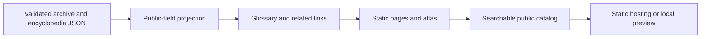

# Roda Kekacauan Wiki

I built a portable static character archive and illustrated world encyclopedia for Roda Kekacauan. I implemented schema validation, public-field projection, static-page generation, glossary links, category/search navigation and atlas generation.

Developed by [Vavan Farizzaman](https://github.com/VavanZaa).

## Algorithm

1. Validate character and encyclopedia JSON against explicit schema and publication rules.
2. Project records onto allowed public fields, keeping draft/private character data outside the generated site.
3. Build a normalized glossary and resolve curated cross-references without producing nested links.
4. Generate character/article routes, a searchable catalog and the illustrated atlas.
5. Copy only required public assets and version script/style URLs using content identity.
6. Serve the generated static site; browsing and search require no hosted database or inference service.

## Workflow



## Run

Commands below assume a Windows terminal at the repository root unless stated otherwise.

```powershell
npm run build
npm run preview
# Source-level checks:
npm test
```

## Code map

`web/`: UI and public models; `scripts/`: validators, builders and public-record projection; `data/`: public encyclopedia and an empty character archive; `tests/`: schema/build/link checks. Synthetic examples remain separate from actual characters.

## Scope and evidence

The repository publishes an empty character archive and the project's explicitly synthetic example generator. Owner draft records and hosting credentials are excluded. The encyclopedia mixes mythology/reference context with authored game adaptations; those sources do not independently validate the game's numerical balance. Optional catalog synchronization needs the separate framework source.

This is a focused source snapshot. Installed dependencies, local environments and bulk generated research assets are rebuilt or supplied separately. See [VALIDATION.md](VALIDATION.md) for the checks performed on this export and any remaining setup requirements.
